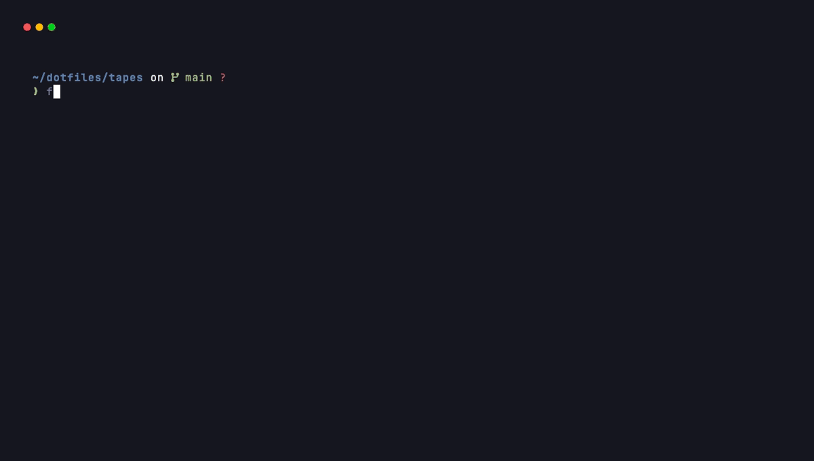
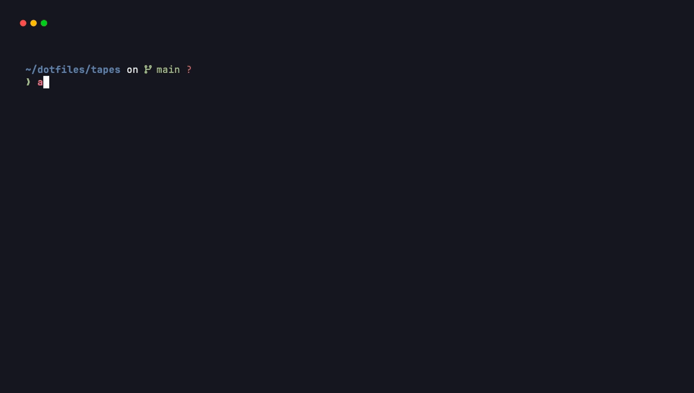
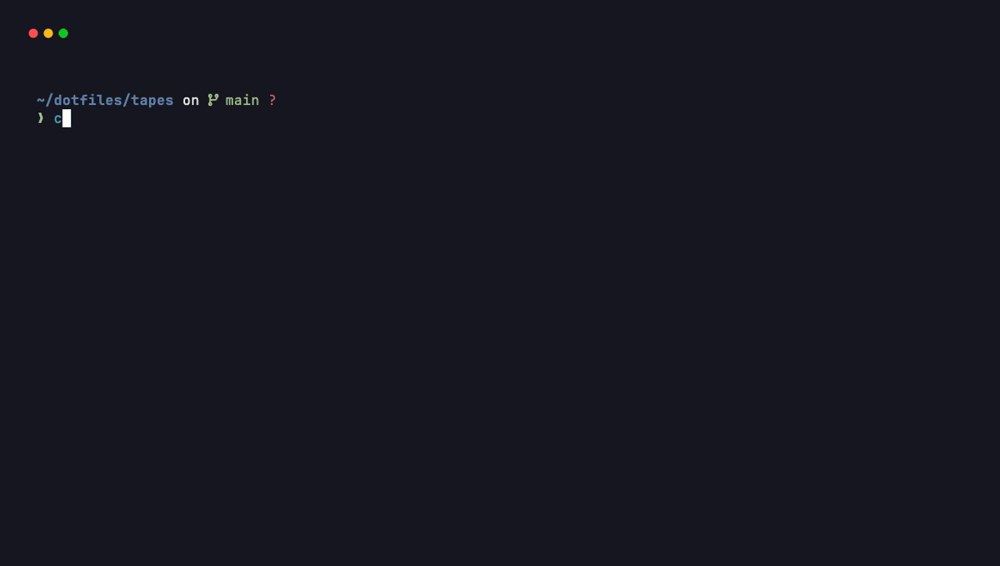
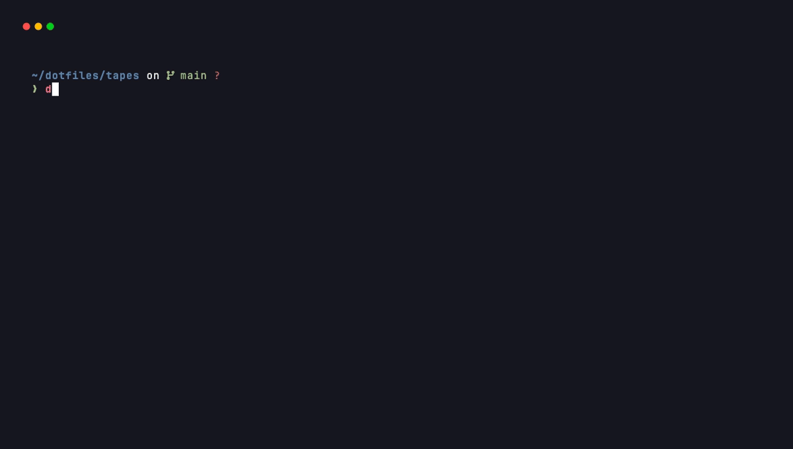

# ⚡ Modern Dotfiles & Nacel AI Terminal Suite

<div align="center">

[](https://apple.com)
[](https://cachyos.org)
[](https://ubuntu.com)
[](https://learn.microsoft.com/en-us/windows/wsl/)

[](https://wezfurlong.org/wezterm/)
[](https://www.zsh.org/)
[](https://starship.rs)
[-8A2BE2?style=flat-square&logo=ollama&logoColor=white)](https://ollama.com)
[](https://github.com/folke/tokyonight.nvim)
[-0052FF?style=flat-square&logo=virustotal&logoColor=white)](https://www.virustotal.com/gui/url/09df21ef8168be8e4de057db3ce503148c2e0bb15795dc6c328ae2fbd38740b6)

**[🇬🇧 English](#-english)** • **[🇪🇸 Español](#-español)**

</div>

---

<a name="-english"></a>
## 🇬🇧 English

A high-performance, aesthetically crafted dotfiles setup featuring **WezTerm**, **Zsh**, **Starship**, modern CLI replacements, and **Nacel AI** (a local, privacy-first AI terminal assistant powered by Ollama).

Designed with out-of-the-box cross-platform support for **macOS**, **CachyOS / Arch Linux**, **Ubuntu / Debian**, and **Windows 11 (WSL2)**.

### 🌟 Showcase

<div align="center">
  
</div>

<br />

<div align="center">

| Interactive Natural Language Commands (`ask`) | Command Auto-Fix & Diagnostics (`fix` / `Ctrl+G`) |
| :---: | :---: |
|  |  |

| Command & Feature Menu (`nacel menu`) | Code & Architecture Explainer (`nacel explain`) |
| :---: | :---: |
|  |  |

</div>

---

### ✨ Features

- 🖥️ **WezTerm (GPU Accelerated)**:
  - **Tokyo Night** color scheme with native macOS acrylic blur and 60% window opacity.
  - **Victor Mono** & **JetBrainsMono Nerd Font** typography with code ligatures (`calt`, `clig`, `liga`).
  - WebGPU rendering engine targeting up to 120 FPS.
  - Custom status bar showing current workspace, git branches, system battery, and datetime.
  - Seamless WSL2 bridging on Windows environments.

- 🤖 **Nacel AI Copilot**:
  - Fully local, offline-first AI assistant using Ollama (`gemma2:2b` by default, configurable).
  - `ask "<query>"`: Translates natural language queries into shell commands with interactive confirmation.
  - `fix` or `Ctrl + G`: Instant root-cause diagnosis and correction for the last failed command.
  - `nacel explain <file>`: Deep breakdown of code logic, abstractions, and architecture.
  - `nacel debug <trace/error>`: Analyzes stack traces and anomalous execution logs.
  - `nacel menu`: Interactive terminal selector with shortcuts.
  - Bilingual interface (switch between English and Spanish on the fly).

- 🐚 **Zsh & Starship**:
  - Ultra-fast startup with compiled configuration (`zcompile`).
  - Auto-completion (`compinit`), syntax highlighting, autosuggestions, and substring search.
  - Minimalist and responsive **Starship** prompt displaying runtime versions (Python, Node, Rust, Go) and git states.

- ⚡ **Modern CLI Replacements**:
  - [`eza`](https://github.com/eza-community/eza): Modern replacement for `ls` (`ll`, `lt`, `tree`) with icons, permissions, and git status.
  - [`bat`](https://github.com/sharkdp/bat): Syntax-highlighting replacement for `cat`.
  - [`atuin`](https://github.com/atuinsh/atuin): Magical SQLite-powered fuzzy shell history search (`Ctrl + R`).
  - [`zoxide`](https://github.com/ajeetdsouza/zoxide): Smarter directory navigation (`z <directory>`).
  - [`fastfetch`](https://github.com/fastfetch-cli/fastfetch): Fast and stylish system information banner upon terminal launch.

---

### 📦 Repository Structure

```text
dotfiles/
├── fastfetch/            # Fastfetch configurations & custom logos/themes
├── startship/            # Starship cross-shell prompt configuration (starship.toml)
├── tapes/                # VHS recording scripts (.tape) and animated GIFs
│   ├── render_all.sh     # Batch renderer for demo videos and GIFs
│   └── README.md         # VHS tape documentation
├── wezterm/              # GPU-accelerated terminal configuration (.wezterm.lua)
├── zsh/                  # Zsh shell configuration (.zshrc)
└── install.sh            # Automated bilingual installer script (integrates Nacel AI)
```

---

### 🚀 Quick Start / Installation

Clone the repository to your home directory:

```bash
git --version || sudo apt install -y git || sudo pacman -S git
git clone https://github.com/dannielnavas/dotfiles.git ~/dotfiles
cd ~/dotfiles
```

Run the automated interactive installer:

```bash
chmod +x install.sh
./install.sh
```

#### Non-Interactive / Flagged Installation

You can specify the language and target operating system directly using flags:

```bash
# Example: English on macOS
./install.sh --en --macos

# Example: English on CachyOS / Arch Linux
./install.sh --en --cachyos

# Example: English on Ubuntu / Debian
./install.sh --en --linux

# Example: English on Windows 11 WSL2
./install.sh --en --wsl2
```

> [!TIP]
> Run `./install.sh --help` to view all available CLI parameters and options.

---

### ⌨️ Cheat Sheet & Keybindings

#### Nacel AI Commands

| Command | Shortcut | Description |
| :--- | :---: | :--- |
| `ask "<prompt>"` | — | Translates natural language into commands with interactive execution |
| `fix` | <kbd>Ctrl</kbd> + <kbd>G</kbd> | Diagnoses and repairs the last failed terminal command |
| `nacel menu` | — | Interactive selector with all AI features and modes |
| `nacel` or `nacel chat` | — | Starts an interactive chat conversation session |
| `nacel explain <file>` | — | Explains code logic, architecture, and syntax |
| `nacel debug <log/file>` | — | Performs root cause analysis on error messages or logs |
| `nacel model [set <m>]` | — | Checks Ollama status and switches the active AI model |
| `nacel lang [es\|en]` | — | Changes or displays the active language |

#### WezTerm Shortcuts

| Action | Shortcut |
| :--- | :--- |
| Split Pane Horizontally | <kbd>Cmd</kbd> / <kbd>Alt</kbd> + <kbd>Shift</kbd> + <kbd>D</kbd> |
| Split Pane Vertically | <kbd>Cmd</kbd> / <kbd>Alt</kbd> + <kbd>D</kbd> |
| Close Pane | <kbd>Cmd</kbd> / <kbd>Alt</kbd> + <kbd>W</kbd> |
| Navigate Panes | <kbd>Cmd</kbd> / <kbd>Alt</kbd> + <kbd>H</kbd> / <kbd>J</kbd> / <kbd>K</kbd> / <kbd>L</kbd> |
| New Tab | <kbd>Cmd</kbd> / <kbd>Alt</kbd> + <kbd>T</kbd> |
| Toggle Fullscreen | <kbd>Cmd</kbd> / <kbd>Alt</kbd> + <kbd>Enter</kbd> |
| Quick Search Mode | <kbd>Cmd</kbd> / <kbd>Ctrl</kbd> + <kbd>Shift</kbd> + <kbd>F</kbd> |

#### Navigation & Shell Shortcuts

| Command / Alias | Tool | Function |
| :--- | :--- | :--- |
| `ls` | `eza` | Colorized list with file icons and directories first |
| `ll` | `eza` | Detailed list with permissions, file sizes, and git status |
| `lt` / `tree` | `eza` | Two-level recursive tree view |
| `cat <file>` | `bat` | View file with syntax highlighting (no paging) |
| `preview <file>` | `bat` | View file with line numbers and git diff marks |
| `z <dir>` | `zoxide` | Fast jump to frequently or recently visited directory |
| <kbd>Ctrl</kbd> + <kbd>R</kbd> | `atuin` | Interactive history search with SQLite backend |
| `reload` | `zsh` | Reloads Zsh configuration (`exec zsh`) |

---

### 🛡️ Security & VirusTotal Scan

All dotfiles, installer automation, and Dilix AI scripts in this repository are open, audited, and verified 100% clean:

| Target | Status | Detection Ratio | Scan Report |
| :--- | :---: | :---: | :--- |
| **Repository URL** | ✅ Clean | `0 / 93` | [View VirusTotal Report](https://www.virustotal.com/gui/url/09df21ef8168be8e4de057db3ce503148c2e0bb15795dc6c328ae2fbd38740b6) |
| **`install.sh` Script** | ✅ Clean | `0 / 93` | [View VirusTotal Report](https://www.virustotal.com/gui/url/83482e66d6cbb5e239c1a25ef569e3ccf253fa9516d62fe88d4f70e9203ff4f0) |

- **SHA-256 Checksum (`install.sh`)**:
  ```bash
  8453d02ae662de9aeb77048ac31fb6293e7f5c48e2cacfa1934fb7dd2c5b19f1
  ```
- **Privacy Guarantee**: Dilix AI executes strictly via your local Ollama instance (`localhost:11434`). No commands, code snippets, or system telemetry are uploaded to external cloud servers.

---

<br />

---

<a name="-español"></a>
## 🇪🇸 Español

Configuración de dotfiles moderna, estética y de alto rendimiento que integra **WezTerm**, **Zsh**, **Starship**, utilidades CLI de última generación y **Nacel AI** (asistente inteligente de terminal, local y privado impulsado por Ollama).

Diseñado con soporte nativo y automático para **macOS**, **CachyOS / Arch Linux**, **Ubuntu / Debian** y **Windows 11 (WSL2)**.

### 🌟 Demostración Visual

<div align="center">
  
</div>

<br />

<div align="center">

| Comandos en Lenguaje Natural (`ask`) | Autocorrección y Diagnóstico (`fix` / `Ctrl+G`) |
| :---: | :---: |
|  |  |

| Menú de Opciones y Acciones (`nacel menu`) | Explicación de Código y Arquitectura (`nacel explain`) |
| :---: | :---: |
|  |  |

</div>

---

### ✨ Características Principales

- 🖥️ **WezTerm (Acelerado por GPU)**:
  - Paleta de color **Tokyo Night** con desenfoque acrílico nativo en macOS y 60% de opacidad.
  - Tipografía **Victor Mono** y **JetBrainsMono Nerd Font** con ligaduras de código (`calt`, `clig`, `liga`).
  - Motor de renderizado WebGPU a 120 FPS fluidos.
  - Barra de estado personalizada con espacio de trabajo actual, ramas de git, nivel de batería y reloj.
  - Enlace automático puente para Windows hacia entornos WSL2.

- 🤖 **Copiloto Nacel AI**:
  - Asistente de inteligencia artificial 100% local y privado mediante Ollama (`gemma2:2b` por defecto, configurable).
  - `ask "<consulta>"`: Traduce consultas en lenguaje cotidiano a comandos de shell con confirmación interactiva.
  - `fix` o `Ctrl + G`: Diagnóstico inmediato de causa raíz y reparación del último comando fallido.
  - `nacel explain <archivo>`: Desglose conceptual de la lógica, arquitectura y dependencias de código fuente.
  - `nacel debug <traza/error>`: Análisis de stack traces y registro de errores de consola.
  - `nacel menu`: Panel interactivo para seleccionar acciones rápidamente.
  - Soporte bilingüe completo (cambia entre Español e Inglés al instante).

- 🐚 **Zsh y Starship**:
  - Inicio instantáneo gracias a la precompilación de scripts (`zcompile`).
  - Autocompletado inteligente (`compinit`), resaltado de sintaxis, sugerencias en tiempo real y búsqueda en subcadenas del historial.
  - Prompt moderno y minimalista con **Starship**, mostrando entornos activos (Python, Node, Rust, Go) y estado de Git.

- ⚡ **Herramientas de Consola Modernas**:
  - [`eza`](https://github.com/eza-community/eza): Sustituto moderno de `ls` (`ll`, `lt`, `tree`) con iconos, permisos y estado de git.
  - [`bat`](https://github.com/sharkdp/bat): Sustituto de `cat` con resaltado de sintaxis enriquecido.
  - [`atuin`](https://github.com/atuinsh/atuin): Historial inteligente respaldado por base de datos SQLite (`Ctrl + R`).
  - [`zoxide`](https://github.com/ajeetdsouza/zoxide): Navegación rápida entre directorios (`z <carpeta>`).
  - [`fastfetch`](https://github.com/fastfetch-cli/fastfetch): Información del sistema con logos y temas visuales al iniciar la terminal.

---

### 📦 Estructura del Repositorio

```text
dotfiles/
├── fastfetch/            # Configuraciones de Fastfetch y temas/logos visuales
├── startship/            # Configuración de prompt Starship (starship.toml)
├── tapes/                # Scripts de grabación VHS (.tape) y archivos GIF
│   ├── render_all.sh     # Script para renderizar todos los GIFs de demostración
│   └── README.md         # Documentación de los tapes de VHS
├── wezterm/              # Configuración de terminal WezTerm (.wezterm.lua)
├── zsh/                  # Configuración de shell Zsh (.zshrc)
└── install.sh            # Script de instalación automatizada bilingüe (integra Nacel AI)
```

---

### 🚀 Instalación Rápida

Clona el repositorio en tu carpeta de usuario:

```bash
git --version || sudo apt install -y git || sudo pacman -S git
git clone https://github.com/dannielnavas/dotfiles.git ~/dotfiles
cd ~/dotfiles
```

Ejecuta el asistente interactivo:

```bash
chmod +x install.sh
./install.sh
```

#### Instalación con Argumentos Directos

Puedes omitir los menús interactivos indicando el idioma y el sistema operativo mediante banderas:

```bash
# Ejemplo: Español en macOS
./install.sh --es --macos

# Ejemplo: Español en CachyOS / Arch Linux
./install.sh --es --cachyos

# Ejemplo: Español en Ubuntu / Debian
./install.sh --es --linux

# Ejemplo: Español en Windows 11 WSL2
./install.sh --es --wsl2
```

> [!TIP]
> Ejecuta `./install.sh --help` para ver la lista completa de opciones y comandos disponibles.

---

### ⌨️ Guía Rápida de Atajos y Comandos

#### Comandos de Nacel AI

| Comando | Atajo | Descripción |
| :--- | :---: | :--- |
| `ask "<consulta>"` | — | Convierte lenguaje natural en comandos con opción de ejecución directa |
| `fix` | <kbd>Ctrl</kbd> + <kbd>G</kbd> | Analiza la causa del último error de consola y propone la corrección |
| `nacel menu` | — | Abre el menú interactivo con todas las funciones de IA |
| `nacel` o `nacel chat` | — | Abre una sesión de conversación interactiva con el asistente |
| `nacel explain <archivo>` | — | Explica el funcionamiento y arquitectura del código seleccionado |
| `nacel debug <archivo/error>` | — | Deduce la anomalía a partir de trazas o salidas de depuración |
| `nacel model [set <m>]` | — | Consulta o modifica el modelo activo de Nacel |
| `nacel lang [es\|en]` | — | Consulta o modifica el idioma activo de Nacel |

#### Atajos de WezTerm

| Acción | Atajo |
| :--- | :--- |
| Dividir panel horizontalmente | <kbd>Cmd</kbd> / <kbd>Alt</kbd> + <kbd>Shift</kbd> + <kbd>D</kbd> |
| Dividir panel verticalmente | <kbd>Cmd</kbd> / <kbd>Alt</kbd> + <kbd>D</kbd> |
| Cerrar panel actual | <kbd>Cmd</kbd> / <kbd>Alt</kbd> + <kbd>W</kbd> |
| Cambiar de panel | <kbd>Cmd</kbd> / <kbd>Alt</kbd> + <kbd>H</kbd> / <kbd>J</kbd> / <kbd>K</kbd> / <kbd>L</kbd> |
| Nueva pestaña | <kbd>Cmd</kbd> / <kbd>Alt</kbd> + <kbd>T</kbd> |
| Pantalla completa | <kbd>Cmd</kbd> / <kbd>Alt</kbd> + <kbd>Enter</kbd> |
| Búsqueda interactiva en el búfer | <kbd>Cmd</kbd> / <kbd>Ctrl</kbd> + <kbd>Shift</kbd> + <kbd>F</kbd> |

#### Atajos de Terminal y Utilidades

| Comando / Alias | Herramienta | Utilidad |
| :--- | :--- | :--- |
| `ls` | `eza` | Listado con iconos, colores y directorios primero |
| `ll` | `eza` | Listado completo con permisos, tamaños y estado de git |
| `lt` / `tree` | `eza` | Vista de árbol jerárquico a dos niveles de profundidad |
| `cat <archivo>` | `bat` | Visualiza archivo con sintaxis resaltada y sin paginado |
| `preview <archivo>` | `bat` | Vista detallada con números de línea y modificaciones git |
| `z <directorio>` | `zoxide` | Salto rápido a carpetas frecuentes o recientes |
| <kbd>Ctrl</kbd> + <kbd>R</kbd> | `atuin` | Búsqueda interactiva en el historial de comandos |
| `reload` | `zsh` | Recarga la configuración del shell al vuelo (`exec zsh`) |

---

### 🛡️ Seguridad y Escaneo en VirusTotal

Todos los scripts de instalación, configuraciones y el motor de Dilix AI son transparentes, auditados y están verificados como 100% limpios de malware y amenazas:

| Objetivo | Estado | Detecciones | Reporte de Análisis |
| :--- | :---: | :---: | :--- |
| **URL del Repositorio** | ✅ Limpio | `0 / 93` | [Ver Reporte en VirusTotal](https://www.virustotal.com/gui/url/09df21ef8168be8e4de057db3ce503148c2e0bb15795dc6c328ae2fbd38740b6) |
| **Script `install.sh`** | ✅ Limpio | `0 / 93` | [Ver Reporte en VirusTotal](https://www.virustotal.com/gui/url/83482e66d6cbb5e239c1a25ef569e3ccf253fa9516d62fe88d4f70e9203ff4f0) |

- **Hash SHA-256 de verificación (`install.sh`)**:
  ```bash
  8453d02ae662de9aeb77048ac31fb6293e7f5c48e2cacfa1934fb7dd2c5b19f1
  ```
- **Garantía de Privacidad**: Nacel AI funciona exclusivamente con tu instancia local de Ollama (`localhost:11434`). Ningún comando, fragmento de código ni información del sistema sale hacia servicios en la nube de terceros.

---

### 📄 Licencia

Este proyecto se distribuye bajo la licencia **MIT**. Puedes usarlo, adaptarlo y personalizarlo libremente.
